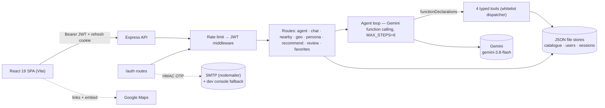

# NaijaTaste AI

**An autonomous Nigerian dining concierge** — a ReAct LLM agent with real tools, JWT
accounts, and location-aware recommendations, shipped as an Express API + React 19 UI.

[](https://github.com/hiamrhex/naijaaste-ai/actions/workflows/ci.yml)
[](LICENSE)

## What you get

- **An agent, not a prompt wrapper** — Gemini chooses among 4 typed tools
  (`search_restaurants`, `get_recommendations`, `generate_review`, `save_preference`)
  inside a 6-step ReAct loop; every call is validated, executed server-side, and traced.
- **Full account lifecycle** — signup/signin (bcrypt cost 12), rotating refresh tokens
  (httpOnly cookie, jti revocation), email-OTP password reset over SMTP: enumeration-safe,
  rate-limited, timing-safe compare.
- **Location-aware** — haversine "near me" search and Google Maps directions across
  60 restaurants in 8 Nigerian cities; heart-to-save favorites per account.
- **Production posture** — helmet, CORS, three-tier rate limiting, generic auth errors,
  request validation, structured error codes, a 19-route health probe.
- **Proven, not promised** — 39 automated tests, ESLint-clean, CI on every push.

## Architecture



The SPA posts the user's message to `POST /agent`; the route verifies the JWT and loads
the chat session. Each turn asks Gemini for tool calls or final text — tool calls hit a
whitelist dispatcher that runs against the JSON stores (the model never touches data
directly) and returns `functionResponse` results. The loop ends on plain text or when the
6-step budget runs out; every step is appended to the trace the UI renders as chips.
Reset OTPs are HMAC-hashed with the JWT secret as pepper and emailed via any SMTP relay.

## Key technical decisions

| Decision | Why | Trade-off |
|---|---|---|
| Gemini native function calling (not regex-parsed JSON) | typed, schema-validated calls; no brittle prompt parsing | vendor lock-in — isolated behind `runAgent` |
| JWT access 15 min + rotating refresh 7 d (jti, cookie scoped to `/auth`) | stateless API, per-token revocation, CSRF-resistant | refresh store is file-backed → single node today |
| bcrypt cost 12 | memory-hard, battle-tested default | ~250 ms signups — deliberate |
| JSON file stores + serialized write queue | zero-setup demo; no infra to run | single-writer; Postgres/Redis are roadmap (plan 007) |
| OTP: HMAC-SHA256 + JWT-secret pepper, `timingSafeEqual`, 10 min TTL / 5 attempts / 60 s cooldown | no plaintext at rest; enumeration-safe responses | OTP map is in-memory — per-instance only |
| Server-side tool whitelist | model cannot invent data access; every arg validated | new capability = code deploy |

## Tech stack

| Layer | Choice |
|---|---|
| Runtime | Node.js 24 |
| API | Express 4.19 · helmet · cors · express-rate-limit |
| Agent | `@google/genai` — `gemini-3.8-flash` (env-overridable), 4 tool schemas, step budget 6 |
| Auth | jsonwebtoken 9 (HS256) · bcrypt 6 · cookie-parser |
| Email | nodemailer 10 over SMTP (dev fallback: OTP in console/UI, never in prod) |
| Frontend | React 19.2 · Vite 8 · lucide-react |
| Tests | Vitest 5 · supertest · ESLint 10 |
| Deploy | Dockerfile (node:24-alpine) · Vercel (SPA) |

## Quick start (~2 minutes)

```bash
git clone https://github.com/hiamrhex/naijaaste-ai.git
cd naijaaste-ai
npm ci
cp .env.example .env      # Windows: copy .env.example .env
npm start                 # API on :3000
npm run dev               # SPA on :5173 (second terminal)
curl http://127.0.0.1:3000/health
```

Paste a free Gemini key (`https://aistudio.google.com/apikey`) into `.env` as
`GEMINI_API_KEY` — auth, nearby, favorites, and tests run without it; the LLM routes
need it. SMTP is optional: without it, dev password-reset codes appear in the UI/console.

### Environment variables

| Variable | Required | Purpose | Example |
|---|---|---|---|
| `GEMINI_API_KEY` | LLM routes | Gemini authentication | `AIza...your_key` |
| `GEMINI_MODEL` | no (default `gemini-3.8-flash`) | model override | `gemini-3.8-flash` |
| `PORT` | no (default `3000`) | API port | `3000` |
| `JWT_ACCESS_SECRET` | yes | access-token pepper | 32-byte random |
| `JWT_REFRESH_SECRET` | yes | refresh-token pepper | 32-byte random |
| `SMTP_HOST` / `SMTP_PORT` / `SMTP_USER` / `SMTP_PASS` | no | OTP email delivery | `smtp.example.com` / `587` |
| `SMTP_FROM` | no | From header | `NaijaTaste AI <noreply@example.com>` |
| `VITE_API_URL` | no (default `http://localhost:3000`) | SPA → API base | `https://api.example.com` |

## API overview

| Method | Path | Auth | Purpose |
|---|---|---|---|
| GET | `/health` | — | status + full route inventory |
| POST | `/auth/signup` · `/auth/signin` | — | create account / session (bcrypt 12) |
| POST | `/auth/refresh` · `/auth/signout` | refresh cookie | rotate / revoke session |
| POST | `/auth/forgot-password` · `/auth/reset-password` | — (OTP) | email a 6-digit code, set new password |
| GET | `/auth/me` | JWT | current user |
| GET/POST | `/auth/favorites` · DELETE `/auth/favorites/:id` | JWT | saved restaurants |
| POST | `/agent` | JWT | autonomous tool-using agent (trace included) |
| POST | `/chat` · DELETE `/chat/:sessionId` | — | scripted chat service + sessions |
| GET | `/nearby?lat&lng&limit&radius_km` | — | haversine-sorted nearby search |
| GET | `/restaurants/geo?ids=` | — | coordinates for map pins |
| POST | `/extract-persona` · `/update-preference` | — | LLM taste-profile extraction |
| POST | `/recommend` · `/generate-review` | — | scored recommendations / LLM reviews |

Rate limits: 600 req/15 min global · 20/15 min auth · 10/15 min password-reset.

## Tests, evals, CI

```bash
npm test           # 122 tests across 19 suites (run: npm test)
npm run lint       # ESLint — clean
npm run evaluate   # NDCG@5 + RMSE over LLM-generated reviews (needs GEMINI_API_KEY)
```

CI (GitHub Actions) runs `npm ci → lint → test → build` on every push and PR, Node 24 —
badge above reflects the latest run.

## Deployment (production: Vercel + Neon Postgres)

All runtime state lives in Postgres — no JSON files, no in-memory maps —
so the API runs fine as a serverless function next to the SPA:

1. **Database (Neon, free tier, no card):** create a project → run migrations
   with the *direct* URL → `npm run db:migrate` with `DATABASE_URL_DIRECT` set.
   Runtime uses the *pooled* URL (`DATABASE_URL`). Without it, production
   refuses to boot; tests/dev use ephemeral pg-mem automatically.
2. **Vercel:** import the repo (Vite preset, output `dist/`). `vercel.json`
   rewrites `/api/*` to `api/index.js` (60s `maxDuration` for slow Gemini
   calls); the SPA calls same-origin `/api/…` by default. Set env vars:
   `GEMINI_API_KEY`, `JWT_ACCESS_SECRET`, `JWT_REFRESH_SECRET`,
   `DATABASE_URL` (pooled), `CORS_ORIGIN` (= your Vercel domain, required),
   `SMTP_*`, `GOOGLE_CLIENT_ID`, `ADMIN_EMAILS`, `NODE_ENV=production`.
3. **Data refresh:** `npm run data:refresh` imports Lagos/Abuja/Port Harcourt/
   Ibadan from OpenStreetMap (polite: User-Agent, ~1.5s gaps, mirrors).
   A daily GitHub Actions workflow (`.github/workflows/refresh.yml`) re-runs
   it — add `DATABASE_URL` + `DATABASE_URL_DIRECT` as repo secrets.
   Attribution: © OpenStreetMap contributors (ODbL).

## Project structure

```
src/
  agent/       ReAct loop, 4 tool schemas + dispatcher, system prompt
  auth/        OTP issue/verify, JWT tokens, user store (bcrypt)
  routes/      auth · agent · chat · nearby · persona · recommend · review · ratings · reports · admin
  services/    email (SMTP), chat, persona, recommend, review
  db/          pg pool (Neon/pg-mem), migrations runner, catalogue loader + seed
  utils/       geo (haversine), validation
  components/  AuthGate, NearbyPanel, RestaurantCard, chat UI
  data/        restaurants.json (seed fixture only — runtime state is Postgres)
migrations/    001 restaurants · 002 users/sessions/OTP/ratings/reports
tests/         vitest suites — 122 tests
plans/         25-layer backend audit + implementation plans
```

## Honest limitations & roadmap

- All runtime state is Postgres (users, sessions, OTP, ratings, reports,
  catalogue) — multi-instance safe; tests run the same SQL on ephemeral pg-mem.
- Restaurant coordinates are area centroids — distances are approximate, not door-to-door.
- Built against the **Backend Engineering Mastery 25-layer checklist** (see
  `plans/README.md` for the live coverage map): auth cluster, rate limiting, health, and
  secrets pass; structured logging, request-ids, and a typed error contract are the
  remaining gap plans (003–006).
- `gemini-3.8-flash` occasionally 503s under demand — retries with backoff are built in.
- WhatsApp reservations integration (PRD) and a demo recording are in progress.

## License & author

MIT © [Team PRiME](https://github.com/hiamrhex) — built for the DSN × BCT LLM Agent
Challenge 3.0.
