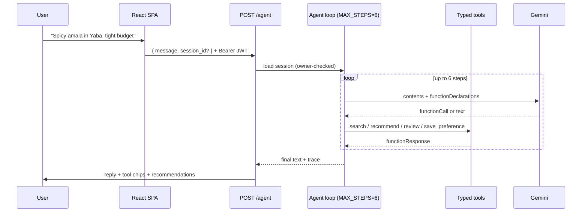
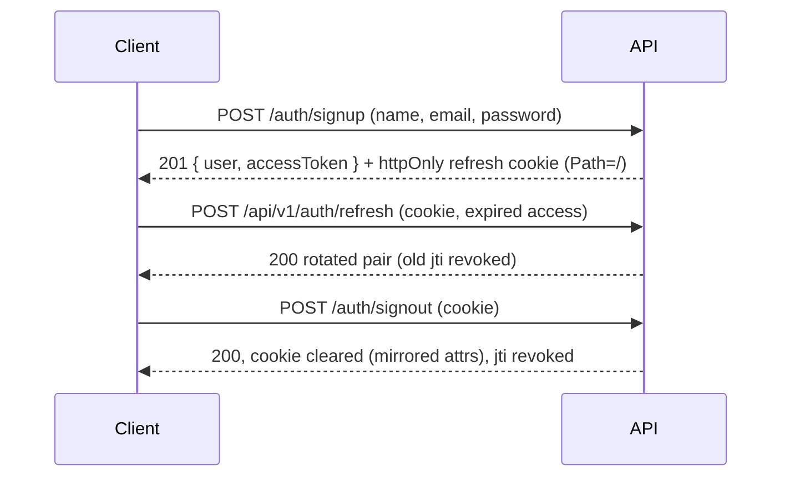
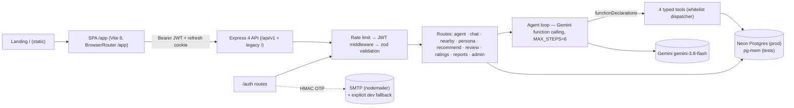
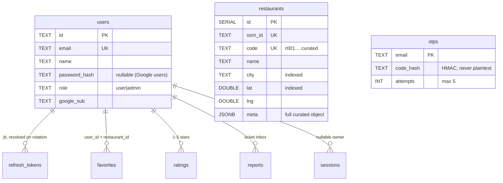
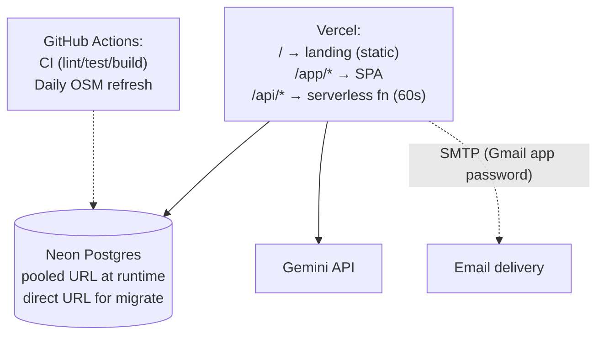

# NaijaTaste AI — Stop scrolling. Start tasting.

**An autonomous Nigerian dining concierge.** Chat once about your city, budget and cravings — get ranked restaurant picks with reasons, directions and AI-written reviews.

[](https://github.com/hiamrhex/naijaaste-ai/actions/workflows/ci.yml)
[](LICENSE)


> **Live demo:** not deployed yet — run it locally in 3 minutes ([Quick start](#quick-start--3-minutes)) or deploy via [Deployment](#deployment). The marketing front door lives at `/`, the app at `/app`.


## Table of contents

- [Problem and solution](#problem-and-solution)
- [Features](#features)
- [How it works](#how-it-works)
- [Architecture](#architecture)
- [Key decisions](#key-decisions)
- [Tech stack](#tech-stack)
- [Quick start (~3 minutes)](#quick-start-3-minutes)
- [Environment](#environment)
- [API summary](#api-summary)
- [Security summary](#security-summary)
- [Testing and quality](#testing-and-quality)
- [Performance and reliability](#performance-and-reliability)
- [Operations](#operations)
- [Deployment](#deployment)
- [Data and attribution](#data-and-attribution)
- [Roadmap and known limitations](#roadmap-and-known-limitations)
- [Project structure](#project-structure)
- [Troubleshooting](#troubleshooting)
- [Contributing](#contributing)
- [License, author, acknowledgements](#license-author-acknowledgements)

## Problem and solution

Choosing where to eat in a Nigerian city means forty open tabs, generic directories that rank by ads, and picks that ignore your budget, spice tolerance and side of town.

NaijaTaste AI flips it: **one conversation → a taste persona → a ranked shortlist with reasons.** A ReAct agent searches, scores, reviews and remembers — and shows its work in a visible tool trace.

## Features

| Capability | How | Status |
|---|---|---|
| 🤖 ReAct agent chat | Gemini reasons in a 6-step loop over 4 typed tools; every step traced in the UI | Live |
| 🧬 Taste persona | City, budget, spice, ambience, dietary flags extracted from chat | Live |
| 📍 Near-you search | Bounding-box prefilter + haversine sort, one-tap Google Maps directions | Live |
| ❤️ Favorites | Per-account, synced across devices | Live |
| ✍️ AI reviews | Written from your persona, matched to the restaurant | Live (LLM-dependent) |
| 🔐 Real auth | JWT (15-min access + rotating refresh), bcrypt-12, email-OTP reset, Google sign-in, admin roles | Live |
| ⭐ Ratings + reports | 1–5 check-ins and a feedback inbox with ticket IDs | Stored; ratings not yet consumed by ranking |
| 🗺️ Map / Plan / History / Settings / Admin screens | Bottom tabs + sidebar shell exist | **Placeholders** — only Home is a real screen |
| 📲 Installable PWA | Plugin installed | **Unwired** — no manifest/service worker yet |

## How it works

One agent turn, end to end:



Auth and refresh, the short version:



## Architecture



Component responsibilities: [`docs/ARCHITECTURE.md`](docs/ARCHITECTURE.md) (request lifecycle, failure modes, scaling limits, first bottlenecks).

Entity model (abridged — full DDL in `migrations/001_restaurants.sql`, `migrations/002_core_tables.sql`):



Deployment topology:



## Key decisions

| Decision | Alternatives | Why | Trade-off | ADR |
|---|---|---|---|---|
| Same SQL on Neon + pg-mem | Prisma/Drizzle, JSON stores | Zero ORM, tests prove prod queries | Hand-written SQL reviewed carefully | [`docs/adr/001-postgres.md`](docs/adr/001-postgres.md) |
| Same-origin `/api` on Vercel | Separate API host, CORS setup | No CORS in hot path, cookies just work | Vercel Hobby 300s/4.5MB ceilings apply | [`docs/adr/002-vercel-same-origin.md`](docs/adr/002-vercel-same-origin.md) |
| Landing at `/`, app at `/app` | SPA at root, subdomain split | Marketing front door + shareable app URLs | Dev serves app at `/app.html` (documented) | [`docs/adr/003-front-door.md`](docs/adr/003-front-door.md) |
| Deterministic pre-score + LLM narrative | Pure LLM ranking | Rankings survive LLM outages; cheaper calls | Two code paths to maintain | [`docs/adr/004-hybrid-scoring.md`](docs/adr/004-hybrid-scoring.md) |
| JWT + rotating refresh (jti table) | Sessions table, opaque tokens | Stateless API + per-token revocation | Refresh store lookup per rotation | [`docs/adr/005-jwt-rotation.md`](docs/adr/005-jwt-rotation.md) |
| OSM + curated seed catalogue | Google Places (needs card) | Free, no key, ODbL-clean | Sparse Nigerian coverage; unverified listings | [`docs/adr/006-osm-data.md`](docs/adr/006-osm-data.md) |

## Tech stack

| Layer | Choice | Why |
|---|---|---|
| Runtime | Node 24 (local v24.12.0, CI `node:24`) | Current LTS line; native fetch/structuredClone |
| API | Express 4.19, helmet, cors, express-rate-limit | Boring, debuggable, huge hiring pool |
| Validation | zod 3.25 schemas + `validate()` middleware | One contract language, client-safe errors |
| Auth | jsonwebtoken 9 (HS256), bcrypt 6, google-auth-library | Proven primitives, no auth SaaS bill |
| Data | `pg` 8 + Neon; pg-mem (dev-only) for tests | Same-SQL guarantee without Docker in CI |
| Agent | `@google/genai`, `gemini-3.8-flash` (env-overridable) | Cheap + fast; isolated behind `runAgent` |
| Email | nodemailer 10 over SMTP | Any relay works; explicit dev fallback |
| Frontend | React 19, Vite 8, react-router-dom 7, lucide icons | Lazy routes, real URLs, tiny icon set |
| Landing | Zero-dependency HTML/CSS/JS (~29KB) | Loads in milliseconds, nothing to break |
| Tests | Vitest 5 + supertest, ESLint 10 | Same runner for unit + HTTP contract tests |

## Quick start (~3 minutes)

```bash
git clone https://github.com/hiamrhex/naijaaste-ai.git
cd naijaaste-ai
npm ci
cp .env.example .env      # Windows: copy .env.example .env
# Fill GEMINI_API_KEY + JWT_* secrets (see Environment)
npm run db:migrate         # needs DATABASE_URL_DIRECT (no-op safely without a DB)
npm start                  # API on :3000  (second terminal:)
npm run dev                # SPA on :5173 (app also at /app.html in dev)
curl http://127.0.0.1:3000/health   # 27 endpoints inventoried
```

## Environment

| Variable | Required? | Purpose |
|---|---|---|
| `GEMINI_API_KEY` / `JWT_ACCESS_SECRET` / `JWT_REFRESH_SECRET` | **Yes** — boot fails without them | LLM auth, token signing, OTP pepper |
| `DATABASE_URL` (pooled) | **Yes in production** — boot fails without it | runtime Postgres |
| `CORS_ORIGIN` | **Yes in production** — boot fails without it | allowed frontend origin(s) |
| `DATABASE_URL_DIRECT` | Migrate only | direct URL for `npm run db:migrate` |
| `ADMIN_EMAILS` | No — but someone must be admin | comma-separated admin seeding |
| `SMTP_HOST/PORT/USER/PASS/FROM` | No — reset stays fail-closed without them | OTP email delivery (Gmail app password works) |
| `GOOGLE_CLIENT_ID` | No — button hides without it | Google sign-in |
| `DEV_OTP_ENABLED` | No (`false`) — **never `true` outside local dev** | dev OTP fallback |
| `RATE_LIMIT_*`, `GEMINI_MODEL`, `PORT`, `LOG_LEVEL`, `TRUST_PROXY` | No (sane defaults) | tuning |

<details>
<summary>Full default table (click to expand)</summary>

| Variable | Default | Fails boot if missing? |
|---|---|---|
| `GEMINI_MODEL` | `gemini-3.8-flash` | No |
| `PORT` | `3000` | No |
| `NODE_ENV` | `development` | No |
| `LOG_LEVEL` | `info` | No |
| `RATE_LIMIT_API_MAX` | `600` / 15 min | No |
| `RATE_LIMIT_LLM_MAX` | `10` / min, both mounts | No |
| `TRUST_PROXY` | `1` | No |

</details>

## API summary

27 endpoints (live count from `/health`). Full reference with request/response examples: [`docs/API.md`](docs/API.md).

| Area | Highlights |
|---|---|
| Auth | signup/signin (bcrypt-12) · rotating refresh (root-path cookie, mirrored clear) · OTP reset (HMAC, 5 attempts, cooldown, no enumeration) · Google ID-token sign-in · `me` with role |
| Agent + chat | `POST /agent` (JWT, owner-bound sessions, trace) · `POST /chat` + UUID-validated session CRUD |
| Discovery | `GET /nearby` (box prefilter + haversine) · `GET /restaurants/geo` (pin coords) |
| Taste | `POST /extract-persona` · `/update-preference` · `/recommend` (city pushdown) · `/generate-review` (id-first lookup) |
| Engagement | `POST/GET /ratings` (1–5, own history) · `POST /reports` (ticket + diagnostics) |
| Admin | `GET /admin/stats` · inbox + triage (role-gated, 401/403 tested) |

Every error is `{ error: { code, message, details?, requestId } }`; 429s add `Retry-After`; oversized bodies get honest `413`, malformed JSON `400` — never a fake 502.

## Security summary

Threat model, controls and disclosure: [`docs/SECURITY.md`](docs/SECURITY.md) (report via `SECURITY.md`).

- Ownership enforced: cross-user session/favorite/rating access → 403/404 (tested).
- Refresh rotation with reuse detection; logout revokes server-side.
- OTP: HMAC-hashed, 10-min TTL, 5 attempts, 60s cooldown, timing-safe compare, generic responses.
- Rate limits per surface (auth 20, reset 10, LLM 10/min, global 600/15min); `/health` exempt.
- Pino redaction covers OTP/password/credential/token shapes (tested); `dev_otp` gated behind an explicit flag.
- CORS allowlist, fail-closed boot in production; helmet headers; refresh cookie `httpOnly` + root path.

## Testing and quality

```bash
npm test           # 127 tests, 20 files — same SQL on pg-mem as Neon runs
npm run lint       # ESLint — clean
npm run evaluate   # NDCG@5 + RMSE over LLM reviews (needs GEMINI_API_KEY)
```

- Contract tests pin 400/401/403/404/409/413/429 shapes; ownership tests use two live users; limiter tests trip real 429s; redaction tests assert secret absence.
- No flaky-timer/network tests: LLM paths are mocked in-suite (`sessions.test.js`) or assert validation-only 400s.

## Performance and reliability

Only measured numbers, with method:

| Metric | Value | How measured |
|---|---|---|
| `GET /health` localhost | p50 52ms · p95 112ms · max 321ms | 50 sequential requests, n=50, dev laptop |
| Full suite | ~17–24s, 20 files | `npm test` wall time |
| Landing weight | 28,863 bytes, 3 files | `stat` on `public/landing.*` |
| Catalogue seed | 60 rows | `node -e` count of `restaurants.json` |
| Neon live rows | 60 curated + 150 OSM at import day | live SQL counts (re-query needs `DATABASE_URL`; not re-verified today) |

What these do **not** prove: multi-user concurrency, production latency, or 100k-row query plans. k6 + `EXPLAIN ANALYZE` are queued (see Roadmap).

Reliability built in: SIGTERM drain, fail-fast env, per-mount rate limits, LLM 502 mapping without message leaks, session TTL pruning.

## Operations

- Health: `GET /health` (endpoint inventory + feature flags). Uptime check: point UptimeRobot at it (free).
- Logs: pino JSON with `requestId` on every request and error; `LOG_LEVEL` per environment.
- Docs: [`docs/RUNBOOK.md`](docs/RUNBOOK.md) (DB down, Gemini down, leaked secret, bad deploy + rollback).

## Deployment

1. **Neon** (free, no card): create project → `npm run db:migrate` with the direct URL → runtime uses the pooled URL.
2. **Vercel**: import repo (Vite preset, `dist/`). `vercel.json`: `/` serves the landing, `/app/*` the SPA shell, `/api/*` the function (60s budget). Set the env table with `NODE_ENV=production`.
3. **Secrets**: repo secrets `DATABASE_URL` + `DATABASE_URL_DIRECT` power the daily OSM refresh (`.github/workflows/refresh.yml`, manual trigger included).
4. **Post-launch**: verify `/health` + `/` + `/app/login`, create your account (admin via `ADMIN_EMAILS`).

## Data and attribution

Details: [`docs/DATA.md`](docs/DATA.md). 60-row curated seed (verified fields, Nigerian coverage) + daily Overpass imports (Lagos/Abuja/PH/Ibadan; polite User-Agent, mirrors, dedupe, `last_seen`). Restaurant data: © OpenStreetMap contributors (ODbL). Known issues: sparse OSM coverage outside Lagos, unverified OSM listings flagged `verified:false`.

## Roadmap and known limitations

- [ ] k6 load profile + `EXPLAIN ANALYZE` on hot queries (honest numbers before any scale claim).
- [ ] PWA: wire manifest + service worker, or drop the dependency.
- [ ] Admin inbox UI (API-only today) and ratings→recommendations loop (stored, not consumed).
- [ ] Map/Plan/History/Settings screens (shell + tabs exist; `Soon` placeholders today).
- [ ] Neon restore drill into a temp branch (6h PITR window on free plan).
- [x] Postgres for all runtime state · [x] Same-origin Vercel deploy · [x] Failure-shaped errors (413/400/502) · [x] Session ownership · [x] Log redaction.
- LLM success depends on Google-side capacity (clean 502s, never leaks); Overpass reachability varies by network (cron covers it).

## Project structure

```
api/           Vercel serverless entry (strips /api mount prefix)
app.html       SPA shell (/app in prod, /app.html in dev)
index.html     Landing page (front door /)
src/
  agent/       ReAct loop, tool schemas + dispatcher, id-first lookup
  app/         BrowserRouter (/app basename), guards, theme/auth/language providers
  auth/        OTP (HMAC+timing-safe), JWT tokens, PG user store
  db/          pool (Neon/pg-mem), migrations runner, catalogue loader + seed
  routes/      auth · agent · chat · nearby · persona · recommend · review · ratings · reports · admin
  screens/     Home (real) · Auth · Soon placeholders · 404/403
  services/    email (SMTP), chat, persona, recommend, review, places-cache
  ratings/ reports/  PG stores (check-ins, feedback inbox)
  components/  cards, panels, tab bar, auth gate, shell
  data/        restaurants.json — seed fixture only (runtime state is Postgres)
migrations/    001 restaurants · 002 users/sessions/OTP/ratings/reports
tests/         20 files — contracts, ownership, limiter, redaction, PG-backed suites
plans/         audit history + implementation plans (008–014 shipped)
public/        landing.css/js, favicon, icons (landing.html moved to root index.html)
docs/          ARCHITECTURE · API · SECURITY · RUNBOOK · DATA · adr/ · media/
```

## Troubleshooting

Eight errors actually hit in this repo's sessions (not imagined):

| Symptom | Cause | Fix |
|---|---|---|
| `EADDRINUSE :::3000` | zombie node from a prior run | `taskkill /F /PID <id>` (`Stop-Process` silently fails on stuck nodes) |
| Signup shows “Request failed” locally | `CORS_ORIGIN` set to prod URL, or API not running | comment it out locally; `npm start` the API |
| `dev_otp` missing in response | `DEV_OTP_ENABLED` not `true` | set it locally only — never in prod |
| OTP 400s in tests | clock/attempt drift | tests drive `__setOtpExpiry`; don't hand-roll codes |
| OSM import `OSM_FETCH_FAILED` | egress blocks Overpass from some networks | mirrors retry, then daily cron from GitHub's network |
| `= ANY($1)` returns [] on pg-mem | pg-mem array-param gap | use dynamic `IN (...)` lists (portable both drivers) |
| Suite timeouts under parallel load | per-file pg-mem init + bcrypt | `hookTimeout: 60000` in `vitest.config.js`; batched seed INSERT |
| PowerShell `$env:X=''` deletes the var | PS 5.1 empty-string semantics | use `Remove-Item Env:X` intentionally; `127.0.0.1` not `localhost` |

## Contributing

See [`CONTRIBUTING.md`](CONTRIBUTING.md) (setup <10 min, conventional commits, never push red, tests for behavior changes). Security issues: [`SECURITY.md`](SECURITY.md) — private report, no public issues.

## License, author, acknowledgements

MIT © [Team PRiME](https://github.com/hiamrhex) — built for the DSN × BCT LLM Agent Challenge 3.0. Restaurant data © OpenStreetMap contributors (ODbL). Standards consulted: OWASP API Top 10 2023, OWASP LLM Top 10 2025, SRE workbook (SLOs), Twelve-Factor App, DORA capabilities, Neon + Vercel limits docs.
