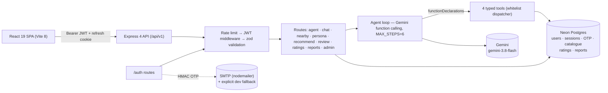

# NaijaTaste AI — Stop scrolling. Start tasting.

**An autonomous Nigerian dining concierge.** Chat once about your city, budget and cravings — get ranked restaurant picks with reasons, directions and AI-written reviews.

[](https://github.com/hiamrhex/naijaaste-ai/actions/workflows/ci.yml)
[](LICENSE)


- **Landing page:** [`public/landing.html`](public/landing.html) — the full product story (pure HTML/CSS/JS, ~29KB, zero dependencies).
- **Live app:** run below → `http://localhost:5173`, or deploy via [Deployment](#deployment).

## What it does

| Capability | How |
|---|---|
| 🤖 **ReAct agent** | Gemini reasons in a 6-step loop over 4 typed tools (`search_restaurants`, `get_recommendations`, `generate_review`, `save_preference`) — every step traced in the UI |
| 🧬 **Taste persona** | City, budget, spice, ambience, dietary flags extracted from chat and refined over time |
| 📍 **Near-you search** | Box-prefiltered haversine search with one-tap Google Maps directions |
| ❤️ **Favorites** | Per-account, synced across devices |
| ✍️ **AI reviews** | Written from your persona, matched to the restaurant |
| 🔐 **Real auth** | JWT (15-min access + rotating refresh), bcrypt-12, email-OTP reset, Google sign-in, admin roles |
| ⭐ **Ratings + reports** | 1–5 check-ins feed future picks; feedback inbox with ticket IDs for admins |
| 📱 **Mobile app shell** | HashRouter + lazy screens, bottom tabs → desktop sidebar, installable PWA path |

## Architecture



One Postgres surface, two drivers: Neon in production, ephemeral pg-mem in tests — the **same SQL** runs on both, so the suite proves production queries.

## Quick start (~3 minutes)

```bash
git clone https://github.com/hiamrhex/naijaaste-ai.git
cd naijaaste-ai
npm ci
cp .env.example .env      # Windows: copy .env.example .env
# Fill GEMINI_API_KEY + JWT_* secrets (see Environment)
npm run db:migrate         # needs DATABASE_URL_DIRECT (or skips to pg-mem locally)
npm start                  # API on :3000  (second terminal:)
npm run dev                # SPA on :5173
curl http://127.0.0.1:3000/health   # 27 endpoints inventoried
```

## Environment

| Variable | Required? | Purpose |
|---|---|---|
| `GEMINI_API_KEY` / `JWT_ACCESS_SECRET` / `JWT_REFRESH_SECRET` | **Yes** — boot fails without them | LLM auth, token signing, OTP pepper |
| `DATABASE_URL` (pooled) | **Yes in production** — boot fails without it | runtime Postgres |
| `CORS_ORIGIN` | **Yes in production** — boot fails without it | allowed frontend origin(s) |
| `DATABASE_URL_DIRECT` | Migrate only | direct URL for `npm run db:migrate` |
| `ADMIN_EMAILS` | No — but someone must be admin | comma-separated admin seeding |
| `SMTP_HOST/PORT/USER/PASS/FROM` | No — reset stays fail-closed without them | OTP email delivery (Gmail app password works) |
| `GOOGLE_CLIENT_ID` | No — button hides without it | Google sign-in |
| `DEV_OTP_ENABLED` | No (`false`) — **never `true` outside local dev** | dev OTP fallback |
| `RATE_LIMIT_*`, `GEMINI_MODEL`, `PORT`, `LOG_LEVEL`, `TRUST_PROXY` | No (sane defaults) | tuning |

## API overview (27 endpoints)

| Method | Path | Auth | Purpose |
|---|---|---|---|
| GET | `/health` | — | status + full route inventory |
| POST | `/auth/signup` · `/auth/signin` | — | account + session (bcrypt-12) |
| POST | `/auth/refresh` · `/auth/signout` | refresh cookie | rotate / revoke (root path, mirrored clear) |
| POST | `/auth/forgot-password` · `/auth/reset-password` | — (OTP) | HMAC-hashed 6-digit code, 5 attempts, cooldown |
| POST | `/auth/google` | — (ID token) | Google sign-in → same JWT session |
| GET | `/auth/me` | JWT | current user (incl. role) |
| GET/POST/DELETE | `/auth/favorites*` | JWT | saved restaurants, enriched items |
| POST | `/agent` | JWT | autonomous agent, owner-bound sessions, trace |
| POST | `/chat` · GET/DELETE | — / UUID-validated | scripted chat + sessions |
| GET | `/nearby` · `/restaurants/geo` | — | box-prefiltered haversine search · pin coords |
| POST | `/extract-persona` · `/update-preference` | — | taste-profile extraction |
| POST | `/recommend` · `/generate-review` | — | city-pushdown scoring + LLM narrative |
| POST/GET | `/ratings` | JWT | 1–5 check-ins, own history |
| POST | `/reports` | JWT | feedback with ticket ID + diagnostics |
| GET/PATCH | `/admin/*` | admin | stats, inbox, triage |

Rate limits: 600/15 min global · LLM 10/min on **both** legacy and `/api/v1` mounts · 20/15 min auth · 10/15 min reset — all 429s carry `requestId` + `Retry-After`.

## Tests, evals, CI

```bash
npm test           # 122 tests, 19 suites — same SQL on pg-mem as Neon runs
npm run lint       # ESLint — clean
npm run evaluate   # NDCG@5 + RMSE over LLM reviews (needs GEMINI_API_KEY)
npm run db:migrate # migrations + 60-row curated seed (needs DATABASE_URL_DIRECT)
npm run data:refresh # OSM import: Lagos/Abuja/PH/Ibadan (polite, mirrored)
```

CI runs `npm ci → lint → test → build` on every push (Node 24). One standing rule: **never push red** — a failing gate stops the line, no exceptions.

## Deployment (Vercel + Neon, both free)

1. **Neon**: free project → `npm run db:migrate` with the direct URL → runtime uses the pooled URL.
2. **Vercel**: import repo (Vite preset, `dist/`). `vercel.json` rewrites `/api/*` to `api/index.js` (60s budget for slow Gemini calls); SPA calls same-origin `/api/…`. Set the env table above with `NODE_ENV=production`.
3. **Secrets**: GitHub repo secrets `DATABASE_URL` + `DATABASE_URL_DIRECT` power the daily OSM refresh (`.github/workflows/refresh.yml`, manual trigger included).
4. **Post-launch**: verify `/health`, create your account (admin via `ADMIN_EMAILS`), UptimeRobot on `/health`.

Restaurant data: © OpenStreetMap contributors (ODbL).

## Project structure

```
api/           Vercel serverless entry (strips /api mount prefix)
src/
  agent/       ReAct loop, tool schemas + dispatcher, id-first lookup
  app/         HashRouter, lazy screens, theme/auth/language providers
  auth/        OTP (HMAC+timing-safe), JWT tokens, PG user store
  db/          pool (Neon/pg-mem), migrations runner, catalogue loader + seed
  routes/      auth · agent · chat · nearby · persona · recommend · review · ratings · reports · admin
  screens/     Home · Map · Plan · History · Settings · Admin (lazy)
  services/    email (SMTP), chat, persona, recommend, review, places-cache
  ratings/ reports/  PG stores (check-ins, feedback inbox)
  components/  cards, panels, tab bar, auth gate, shell
  data/        restaurants.json — seed fixture only (runtime state is Postgres)
migrations/    001 restaurants · 002 users/sessions/OTP/ratings/reports
tests/         122 tests — 400/401/403/404/429 contracts, ownership, limiter, redaction
plans/         audit history + implementation plans (008–014 shipped)
public/        landing.html — the marketing page (zero-dependency)
```

## Honest limitations & roadmap

- LLM success depends on Google-side capacity — failures surface as clean 502s, never leaks; a clean-network retest is pending.
- OSM import reachability varies by network (mirrors + daily cron cover it); curated seed guarantees baseline coverage.
- Queued next: load test at scale (k6), PWA install wiring decision, admin inbox UI, ratings→recommendations loop.
- Built against the **Backend Engineering Mastery 25-layer checklist** and an independent 13-area audit (`plans/README.md`): error contract, structured logging, request IDs, zod validation, per-endpoint rate limits, session ownership, and log redaction all shipped with tests.

## License & author

MIT © [Team PRiME](https://github.com/hiamrhex) — built for the DSN × BCT LLM Agent Challenge 3.0.
