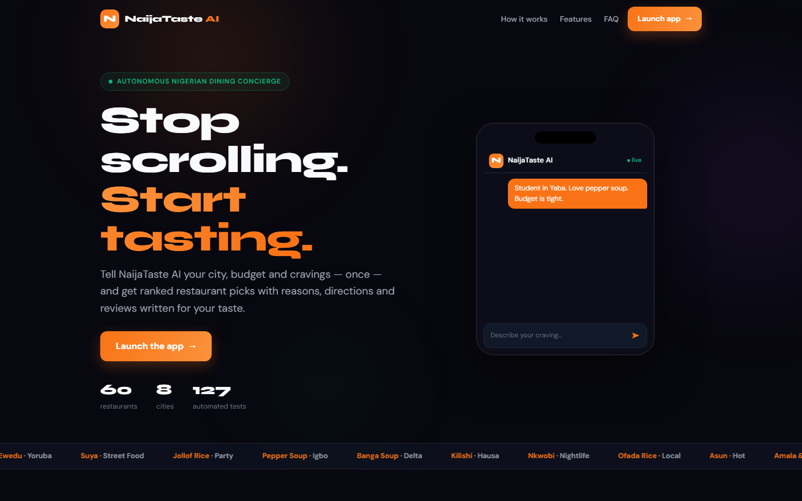
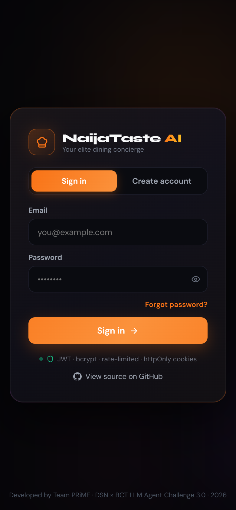
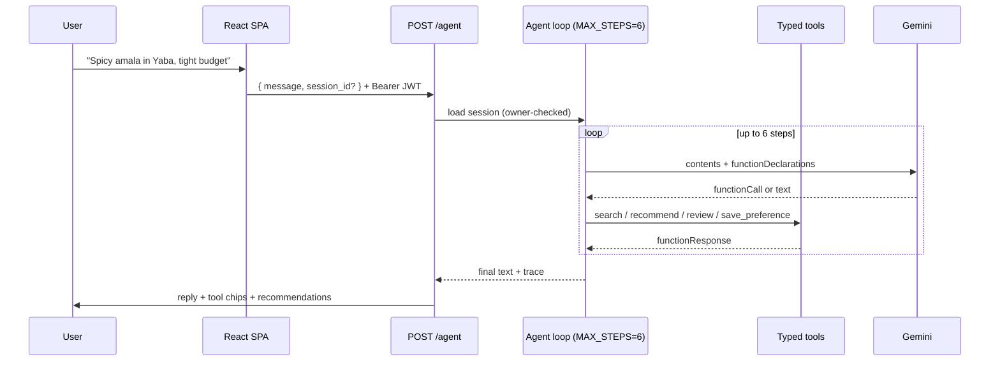
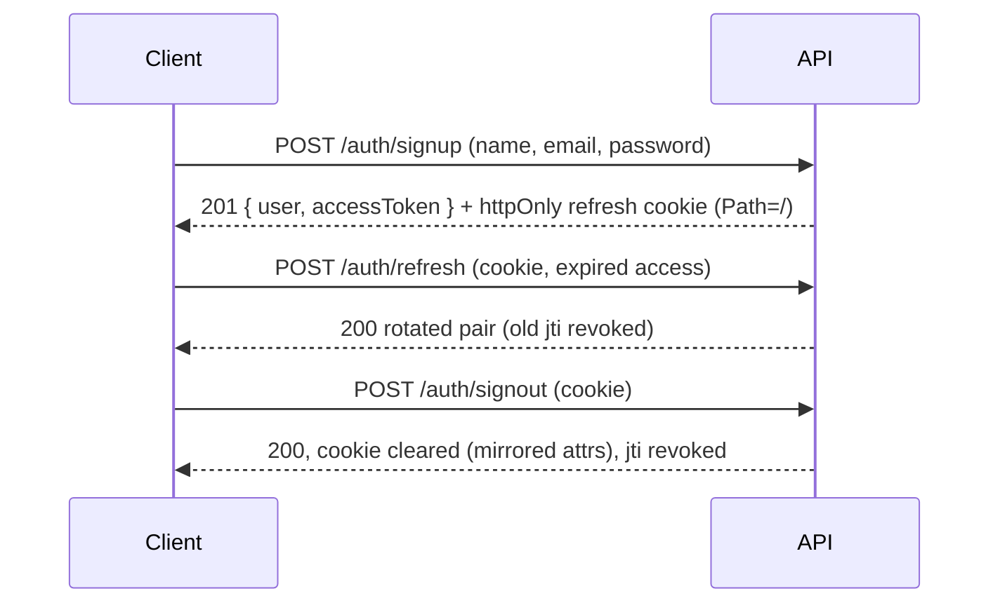
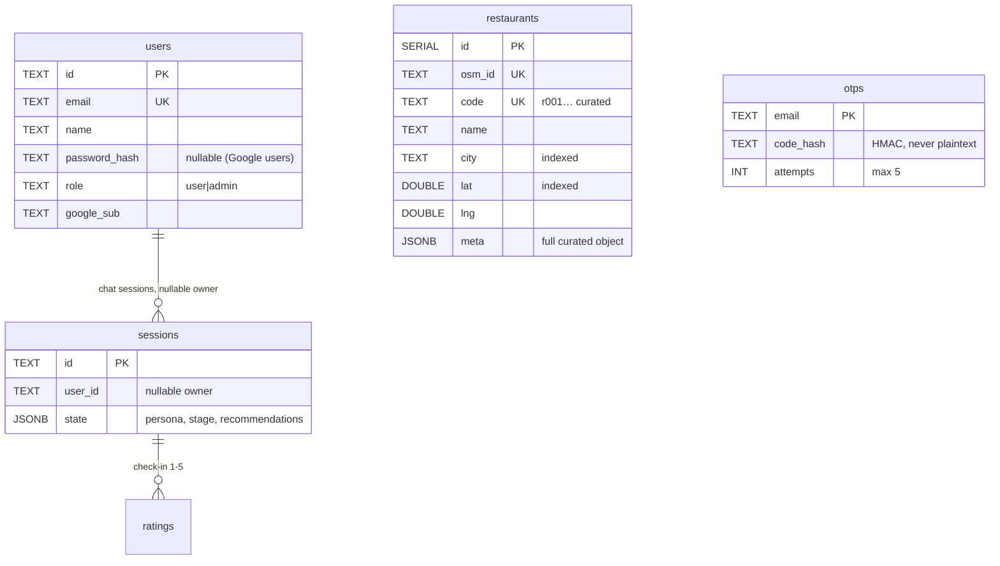
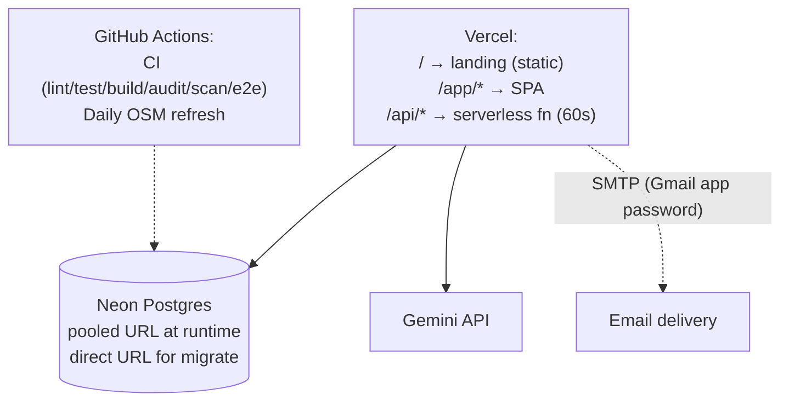

# NaijaTaste AI

**Chat once about your city, budget and cravings — get ranked Nigerian restaurant picks with reasons, directions and AI-written reviews.**

[](https://github.com/hiamrhex/naijaaste-ai/actions/workflows/ci.yml)
[](LICENSE)


> **Status:** landing page, app shell and the API are live at [naijataste-ai.vercel.app](https://naijataste-ai.vercel.app) — `/health` returns 200. Everything below is verified against the code today; evidence lives in [`docs/EVIDENCE.md`](docs/EVIDENCE.md).





## Table of contents

- [Problem and solution](#problem-and-solution)
- [Features](#features)
- [How it works](#how-it-works)
- [Architecture](#architecture)
- [Key decisions](#key-decisions)
- [Tech stack](#tech-stack)
- [Quick start (~3 minutes)](#quick-start-3-minutes)
- [Environment](#environment)
- [API summary](#api-summary)
- [Security summary](#security-summary)
- [Testing and quality](#testing-and-quality)
- [Performance and reliability](#performance-and-reliability)
- [Operations](#operations)
- [Deployment](#deployment)
- [Data and attribution](#data-and-attribution)
- [Roadmap and known limitations](#roadmap-and-known-limitations)
- [Project structure](#project-structure)
- [Troubleshooting](#troubleshooting)
- [Contributing](#contributing)
- [License, author, acknowledgements](#license-author-acknowledgements)

## Problem and solution

Choosing where to eat in a Nigerian city means forty open tabs, generic directories that rank by ads, and picks that ignore your budget, spice tolerance and side of town.

NaijaTaste AI flips it: **one conversation → a taste persona → a ranked shortlist with reasons.** A ReAct agent searches, scores, reviews and remembers — and shows its work in a visible tool trace. When Gemini is down, deterministic scoring keeps recommendations flowing instead of failing.

## Features

| Capability | How | Status |
|---|---|---|
| ReAct agent chat | Gemini reasons in a ≤6-step loop over 4 typed tools; every step traced in the UI | Live |
| Taste persona | City, budget, spice, ambience, dietary flags extracted from chat | Live |
| Near-you search | Indexed bounding-box prefilter + haversine sort, one-tap Google Maps directions | Live |
| Favorites | Per-account, synced across devices | Live |
| AI reviews | Written from your persona, matched to the restaurant by ID first | Live (LLM-dependent) |
| Deterministic fallback | Pre-scored shortlist + honest message when the LLM circuit is open | Live (8/8 drill) |
| Real auth | JWT (15-min access + rotating refresh), bcrypt-12, email-OTP reset, Google sign-in, admin roles | Live |
| Ratings + reports | 1–5 check-ins and a feedback inbox with ticket IDs | Stored; ratings not yet consumed by ranking |
| Map / Plan / History / Settings / Admin screens | Real React screens (Leaflet map, planner form, history search, settings with account deletion, admin stats inbox) | Live |
| Installable PWA | `vite-plugin-pwa` manifest + offline fallback page | Live (manifest + `offline.html` in build) |

## How it works

One agent turn, end to end:



Auth and refresh, the short version:



## Architecture

```mermaid
flowchart LR
  LP["Landing / (static)"] --> APP["SPA /app (Vite 8, BrowserRouter /app)"]
  APP -->|"Bearer JWT + refresh cookie"|   API["Express 4 API (/api/v1; legacy /api/* via rewrite)"]
  API --> MW["Rate limit → JWT middleware → zod validation"]
  MW --> R["Routes: agent · chat · nearby · persona · recommend · review · ratings · reports · admin"]
  R --> AG["Agent loop — Gemini function calling, MAX_STEPS=6"]
  AG -->|"functionDeclarations"| TL["4 typed tools (whitelist dispatcher)"]
  TL --> DB[("Neon Postgres (prod)\npg-mem (tests)")]
  R --> DB
  AG --> GM[("Gemini gemini-3.8-flash")]
  AUTH["/auth routes"] --> MW
  AUTH -.->|"HMAC OTP"| SM[("SMTP (nodemailer)\n + explicit dev fallback")]
```

Component responsibilities, request lifecycle, failure modes and the first scaling bottlenecks: [`docs/ARCHITECTURE.md`](docs/ARCHITECTURE.md).

Entity model (abridged — full DDL in `migrations/001_restaurants.sql`, `migrations/002_core_tables.sql`):



Deployment topology:



## Key decisions

| Decision | Alternatives | Why | Trade-off | ADR |
|---|---|---|---|---|
| Same SQL on Neon + pg-mem | Prisma/Drizzle, JSON stores | Zero ORM, tests prove prod queries | Hand-written SQL reviewed carefully | [`001`](docs/adr/001-postgres.md) |
| Same-origin `/api` on Vercel | Separate API host | No CORS in hot path, cookies just work | Vercel Hobby 300s/4.5MB ceilings | [`002`](docs/adr/002-vercel-same-origin.md) |
| Landing at `/`, app at `/app` | SPA at root | Marketing front door + shareable app URLs | Two HTML entry points | [`003`](docs/adr/003-front-door.md) |
| Deterministic pre-score + LLM narrative | Pure LLM ranking | Rankings survive LLM outages; cheaper calls | Two code paths to maintain | [`004`](docs/adr/004-hybrid-scoring.md) |
| JWT + rotating refresh (jti table) | Sessions table, opaque tokens | Stateless API + per-token revocation | Refresh store lookup per rotation | [`005`](docs/adr/005-jwt-rotation.md) |
| OSM + curated seed catalogue | Google Places (needs card) | Free, no key, ODbL-clean | Sparse coverage outside Lagos | [`006`](docs/adr/006-osm-data.md) |
| pg-mem for tests | Docker Postgres in CI | Same-SQL guarantee without containers | A few pg-mem gaps worked around (dynamic `IN`) | [`007`](docs/adr/007-pg-mem-tests.md) |

## Tech stack

| Layer | Choice | Why |
|---|---|---|
| Runtime | Node 24 (v24.12.0 local, `node:24` in CI) | Current LTS line; native fetch |
| API | Express 4.19, helmet, cors, express-rate-limit | Boring, debuggable, huge hiring pool |
| Validation | zod 3.25 + `validate()` middleware | One contract language, client-safe errors |
| Auth | jsonwebtoken 9 (HS256), bcrypt 6 (cost 12), google-auth-library | Proven primitives, no auth SaaS bill |
| Data | `pg` 8 + Neon; pg-mem (dev-only) for tests | Same-SQL guarantee without Docker in CI |
| Agent | `@google/genai`, `gemini-3.8-flash` (env-overridable) | Cheap + fast; isolated behind `runAgent` |
| Email | nodemailer 10 over SMTP | Any relay works; explicit dev fallback |
| Frontend | React 19, Vite 8, react-router-dom 7, Leaflet, lucide icons | Lazy routes, real URLs, offline-capable map |
| Landing | Zero-dependency HTML/CSS/JS (28,875 bytes total) | Loads in milliseconds, nothing to break |
| Tests | Vitest 5 + supertest + Playwright, ESLint 10 | Same runner for unit + HTTP contract + e2e |

## Quick start (~3 minutes)

```bash
git clone https://github.com/hiamrhex/naijaaste-ai.git
cd naijaaste-ai
npm ci
cp .env.example .env      # Windows: copy .env.example .env
# Fill GEMINI_API_KEY + JWT_ACCESS_SECRET + JWT_REFRESH_SECRET (see Environment)
npm run db:migrate         # needs DATABASE_URL_DIRECT; safe no-op without a DB
npm start                  # API on :3000  (second terminal:)
npm run dev                # SPA on :5173, app at /app
curl http://127.0.0.1:3000/health   # 31 endpoints inventoried
```

No Gemini key? The API still boots; LLM routes return a clean 502 and the
nearby/favorites/auth paths fully work. No database? Tests and keyless dev run
on in-process pg-mem.

## Environment

| Variable | Required? | Purpose |
|---|---|---|
| `GEMINI_API_KEY` / `JWT_ACCESS_SECRET` / `JWT_REFRESH_SECRET` | **Yes** — boot fails without them | LLM auth, token signing |
| `DATABASE_URL` (pooled) | **Yes in production** — boot fails without it | runtime Postgres |
| `CORS_ORIGIN` | **Yes in production** — boot fails without it | allowed frontend origin(s) |
| `DATABASE_URL_DIRECT` | Migrate only | direct URL for `npm run db:migrate` |
| `ADMIN_EMAILS` | No — but someone must be admin | comma-separated admin seeding |
| `SMTP_HOST/PORT/USER/PASS/FROM` | No — reset stays fail-closed without them | OTP email delivery (Gmail app password works) |
| `GOOGLE_CLIENT_ID` | No — button hides without it | Google sign-in |
| `DEV_OTP_ENABLED` | No (`false`) — **never `true` outside local dev** | dev OTP fallback |
| `RATE_LIMIT_*`, `GEMINI_MODEL`, `PORT`, `LOG_LEVEL`, `TRUST_PROXY` | No (sane defaults) | tuning |

<details>
<summary>Full default table (click to expand)</summary>

| Variable | Default | Fails boot if missing? |
|---|---|---|
| `GEMINI_MODEL` | `gemini-3.8-flash` | No |
| `PORT` | `3000` | No |
| `NODE_ENV` | `development` | No |
| `LOG_LEVEL` | `info` | No |
| `RATE_LIMIT_API_MAX` | `600` / 15 min | No |
| `RATE_LIMIT_LLM_MAX` | `10` / min, both mounts | No |
| `TRUST_PROXY` | `1` | No |

</details>

## API summary

31 endpoints (live count from `/health`). Full reference with request/response examples: [`docs/API.md`](docs/API.md).

<details>
<summary>Endpoints by area (click to expand)</summary>

| Area | Endpoints |
|---|---|
| Health | `GET /health` · `GET /health/ready` (DB probe, 2s bounded) |
| Auth | `POST /auth/signup` · `POST /auth/signin` · `POST /auth/refresh` · `POST /auth/signout` · `GET /auth/me` · `DELETE /auth/me` · `POST /auth/google` · `POST /auth/forgot-password` · `POST /auth/reset-password` · `GET/POST /auth/favorites` · `DELETE /auth/favorites/:restaurant_id` · `POST /auth/saved-places` |
| Discovery | `GET /nearby` · `GET /restaurants/geo` |
| Agent + chat | `POST /agent` · `POST /chat` · `GET /chat/:sessionId` · `DELETE /chat/:sessionId` |
| Taste | `POST /extract-persona` · `POST /update-preference` · `POST /recommend` · `POST /generate-review` |
| Engagement | `POST /ratings` · `GET /ratings` · `POST /reports` |
| Admin | `GET /admin/stats` · `GET /admin/reports` · `PATCH /admin/reports/:ticket` |

</details>

Every error is `{ error: { code, message, details?, requestId } }`; 429s add `Retry-After` + `RateLimit` headers; oversized bodies get honest `413`, malformed JSON `400` — never a fake 502. Upstream LLM failures return `502 UPSTREAM_FAILURE` (proven by drill: 8/8, zero 500s).

## Security summary

Threat model (STRIDE), controls inventory and disclosure policy: [`docs/THREAT_MODEL.md`](docs/THREAT_MODEL.md) · [`docs/SECURITY.md`](docs/SECURITY.md) · [`SECURITY.md`](SECURITY.md).

- Ownership enforced (tested): chat sessions return `404` to non-owners (`tests/chat-ownership.test.js`); `/agent` returns `403`; favorites/saved-places filter by owner in SQL (`200 {"removed":false}` / `404`, no data leak).
- Refresh rotation with reuse detection; logout revokes server-side; access tokens never touch localStorage.
- OTP: HMAC-hashed, 10-min TTL, 5 attempts, 60s cooldown, timing-safe compare, generic responses.
- Rate limits per surface (defaults, 15 min unless noted): signup 25, signin 50, refresh 60, Google 10, forgot 10, reset 20, LLM 10/min, global 600/15 min; `/health` exempt. Limiter tests trip real `429`s; live limits were not driven (unverified).
- Security headers: CSP (`script-src 'self'` + Google, `object-src 'none'`, `frame-ancestors 'self'`), `X-Frame-Options`, `nosniff`, `Referrer-Policy`, `Permissions-Policy` ship to HTML documents via `vercel.json` (commit `0156780`, `tests/deployment-config.test.js`) and to API JSON via helmet. Live document-header scan is **pending deployment** (commit `0156780` was not live on 2026-10-21).
- CORS allowlist, fail-closed boot in production; refresh cookie `httpOnly` + `sameSite=strict` + root path.
- Break-it battery (14 attacks) and agent-safety probes (5) recorded in [`docs/EVIDENCE.md`](docs/EVIDENCE.md).

## Testing and quality

```bash
npm test           # full suite — same SQL on pg-mem as Neon runs; count is picked up by CI, not typed here
npm run lint       # ESLint — clean
npm run evaluate   # NDCG@5 + RMSE over LLM reviews (needs GEMINI_API_KEY)
```

CI on every push ([`ci.yml`](.github/workflows/ci.yml)): lint · test · build · service-worker checks · data-quality gate (`data/ng` schemas, duplicate keys, source provenance) · `npm audit --omit=dev --audit-level=critical` · secret scan · Playwright e2e (signup → nearby → save → sign-out).

- Contract tests pin 400/401/403/404/409/413/429 shapes; ownership tests use two live users; limiter tests trip real 429s; redaction tests assert secret absence.
- Failure-path tests: DB down (503 readiness), LLM down (deterministic fallback + clean 502), hung query (bounded timeout).

## Performance and reliability

Only measured numbers, with method. Full ledger: [`docs/EVIDENCE.md`](docs/EVIDENCE.md).

| Metric | Value | How measured |
|---|---|---|
| `GET /health` local (no DB) | 1,687–1,939 rps across c=10→200; p97.5 13→154ms | autocannon, 15s/step, laptop |
| `GET /nearby` local → Neon (remote) | 3 rps at c=10; p97.5 7.3s; collapse at c=50 | autocannon, same setup; bottleneck: pool `max: 3` + ~180ms RTT |
| Full test suite | green in CI (badge above is the source of truth) | vitest wall time ~40s locally |
| Landing weight | 28,875 bytes (3 files) | `stat` on `index.html` + `public/landing.*` |
| Catalogue | 60 curated seed rows; 210 rows live in Neon | JSON count; SQL count during restore drill |
| Neon restore | dump 36.5s → isolated DB → restore 30.8s → counts identical | `pg_dump`/`pg_restore` drill, 2026-10-16 |

> **These are local numbers from one laptop to a remote database over the public internet. They are not representative of Vercel same-region serving.** No production load test has been run.

SLO targets (availability 99.5%, non-AI p95 <500ms, AI p95 <10s, AI success ≥95%) and the error-budget policy: [`docs/SLO.md`](docs/SLO.md). Measurement pipeline is not yet built — the SLOs are review targets, not enforced alerts.

Reliability built in: 20s LLM timeout · exponential backoff · circuit breaker (5 fails/60s cooldown) · deterministic recommend fallback · SIGTERM drain · fail-fast env · session TTL pruning.

## Operations

- Health: `GET /health` (inventory + feature flags), `GET /health/ready` (DB probe, 503 while down).
- Logs: pino JSON with `requestId` on every request and error; secrets redacted (tested).
- Runbook: [`docs/RUNBOOK.md`](docs/RUNBOOK.md) — DB down, Gemini down, leaked secret, bad deploy, abuse spike.
- Postmortems: [`docs/POSTMORTEMS/`](docs/POSTMORTEMS/) — one written ([2026-10-15 chat 500→502](docs/POSTMORTEMS/2026-10-15-chat-500-instead-of-502.md)).
- Not yet configured: uptime monitor, Sentry, SLO alerting (tracked in [`docs/AUDIT.md`](docs/AUDIT.md) gap G-3).

## Deployment

1. **Neon** (free, no card): create project → `npm run db:migrate` with the direct URL → runtime uses the pooled URL.
2. **Vercel**: import repo (Vite preset, `dist/`). `vercel.json` routes `/` → landing, `/app/*` → SPA, `/api/*` → function (60s budget). Set the env table with `NODE_ENV=production` — **the function refuses to boot without `GEMINI_API_KEY`, `JWT_ACCESS_SECRET`, `JWT_REFRESH_SECRET`, `CORS_ORIGIN`, `DATABASE_URL`** (`src/env.js:40-54`).
3. **Secrets**: repo secrets `DATABASE_URL` + `DATABASE_URL_DIRECT` power the daily OSM refresh (`.github/workflows/refresh.yml`, manual trigger included).
4. **Post-launch verify**: `/health` 200 · `/health/ready` 200 · `/` 200 · `/app/login` 200 · one signup → nearby → sign-out round-trip.

## Data and attribution

Details: [`docs/DATA.md`](docs/DATA.md). 60-row curated seed (verified fields, Nigerian coverage) + daily Overpass imports (Lagos/Abuja/PH/Ibadan; polite User-Agent, mirrors, dedupe, `last_seen`). Restaurant data: © OpenStreetMap contributors (ODbL). Known issues: sparse OSM coverage outside Lagos, unverified OSM listings flagged `verified:false`.

## Roadmap and known limitations

- [ ] Production load test on the live Vercel URL (k6 or autocannon, off-peak, free-tier respectful).
- [ ] SLO measurement pipeline + uptime monitor (gap G-3 in AUDIT). [x] Sentry error tracking is shipped — set `SENTRY_DSN` in the Vercel project to arm it.
- [ ] Neon-branch PITR restore drill (needs Neon API key; logical restore drill done).
- [ ] Admin inbox UI (API-only today) and ratings→recommendations loop (stored, not consumed).
- [ ] Chained prompt-injection battery (current: 5 standalone probes, gap G-7).
- [x] Postgres for all runtime state · [x] Same-origin Vercel deploy · [x] Failure-shaped errors (413/400/502) · [x] Session ownership · [x] Log redaction · [x] LLM timeout + breaker + fallback · [x] Restore drill (logical) · [x] SLOs documented
- Known platform limits: LLM success depends on Google-side capacity (clean 502s, never leaks); Overpass reachability varies by network (cron covers it); Neon free tier = single region.

## Project structure

```
api/            Vercel serverless entry (maps /api/* to routers; /api/v1/* kept
                for the canonical mount)
index.html      Landing page (front door /)
app/index.html  SPA shell (/app in prod and dev)
src/
  agent/        ReAct loop, tool schemas + dispatcher, id-first lookup
  app/          BrowserRouter (/app basename), guards, providers
  auth/         OTP (HMAC+timing-safe), JWT tokens, PG user store
  db/           pool (Neon/pg-mem), migrations runner, catalogue + seed
  routes/       auth · agent · chat · nearby · persona · recommend · review · ratings · reports · admin
  screens/      Home · Map (Leaflet) · Plan · History · Settings · Admin · Auth · 404/403
  services/     email (SMTP), chat, persona, recommend, review, llm (breaker/timeout), places-cache
  lib/          auth client, logger (redaction), errors, readiness, push
  ratings/ reports/  PG stores (check-ins, feedback inbox)
  components/   cards, sheets, tab bar, auth gate, shell
  data/         restaurants.json — seed fixture only (runtime state is Postgres)
migrations/     001 restaurants · 002 users/sessions/OTP/ratings/reports
tests/          26 files — contracts, ownership, limiter, redaction, resilience, PG-backed suites
tests/e2e/      Playwright smoke (signup → nearby → save → sign-out)
scripts/        break-it battery · agent-safety probes · secret scan · env audit
public/         landing.css/js, favicon, icons, offline.html
docs/           ARCHITECTURE · API · SECURITY · THREAT_MODEL · SLO · RUNBOOK · DATA · AUDIT · MATURITY · EVIDENCE · adr/ · media/ · POSTMORTEMS/
```

## Troubleshooting

Eight errors actually hit in this repo's sessions:

| Symptom | Cause | Fix |
|---|---|---|
| `EADDRINUSE :::3000` | zombie node from a prior run | `taskkill /F /PID <id>` (`Stop-Process` silently fails on stuck nodes) |
| Signup shows "Request failed" locally | `CORS_ORIGIN` set to prod URL, or API not running | comment it out locally; `npm start` the API |
| `FUNCTION_INVOCATION_FAILED` on Vercel | one of the 5 required env vars missing in the project | set all five; see [Deployment](#deployment) step 2 |
| `dev_otp` missing in response | `DEV_OTP_ENABLED` not `true` | set it locally only — never in prod |
| `= ANY($1)` returns [] on pg-mem | pg-mem array-param gap | use dynamic `IN (...)` lists (portable both drivers) |
| OSM import `OSM_FETCH_FAILED` | egress blocks Overpass from some networks | mirrors retry, then daily cron from GitHub's network |
| Suite timeouts under parallel load | per-file pg-mem init + bcrypt | `hookTimeout: 60000` in `vitest.config.js`; batched seed INSERT |
| PowerShell `$env:X=''` deletes the var | PS 5.1 empty-string semantics | use `Remove-Item Env:X`; prefer `127.0.0.1` over `localhost` |

## Contributing

See [`CONTRIBUTING.md`](CONTRIBUTING.md) (setup <10 min, conventional commits, never push red, tests for behavior changes). Security issues: [`SECURITY.md`](SECURITY.md) — private report, no public issues.

## License, author, acknowledgements

MIT © [Team PRiME](https://github.com/hiamrhex) — built for the DSN × BCT LLM Agent Challenge 3.0. Restaurant data © OpenStreetMap contributors (ODbL). Standards consulted: [OWASP API Top 10 2023](https://owasp.org/API-Security/), [OWASP LLM Top 10 2025](https://genai.owasp.org/llm-top-10/), [Google SRE Book](https://sre.google/sre-book/service-level-objectives/), [Twelve-Factor App](https://12factor.net/), [DORA](https://dora.dev/capabilities/), [Neon limits](https://neon.com/docs/introduction/plans), [Vercel Functions limits](https://vercel.com/docs/functions/limitations). Research and scoring: [`docs/STANDARDS.md`](docs/STANDARDS.md) · [`docs/AUDIT.md`](docs/AUDIT.md) · [`docs/MATURITY.md`](docs/MATURITY.md).
