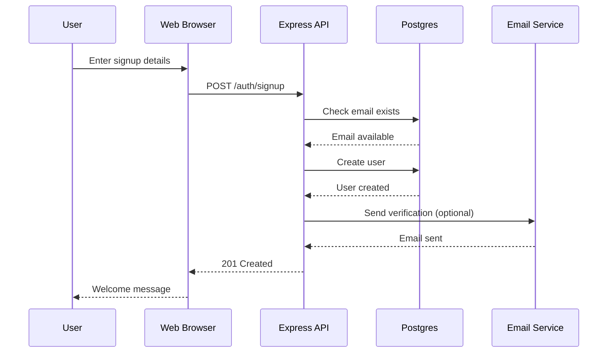
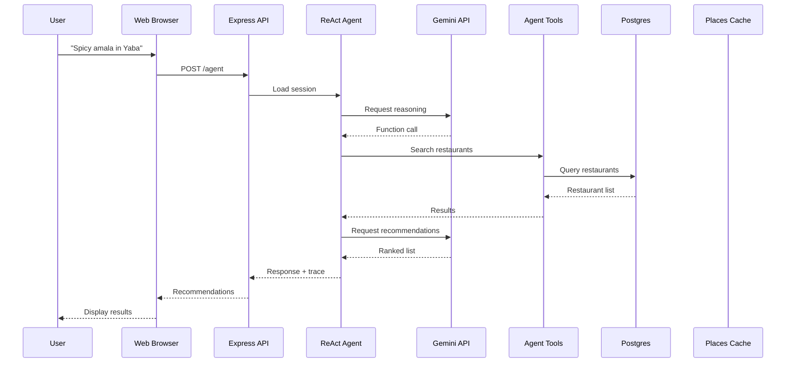
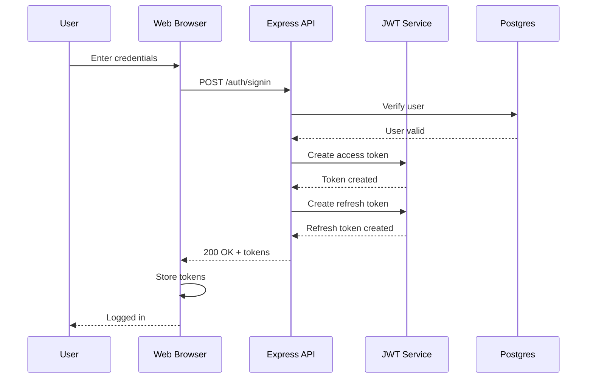
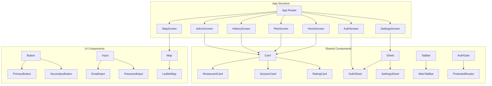
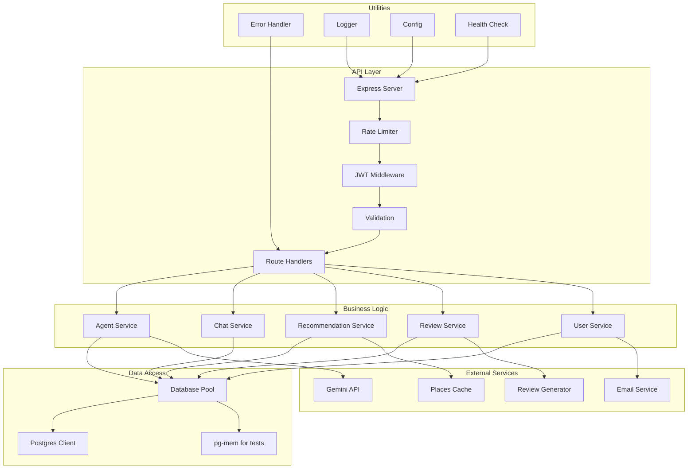
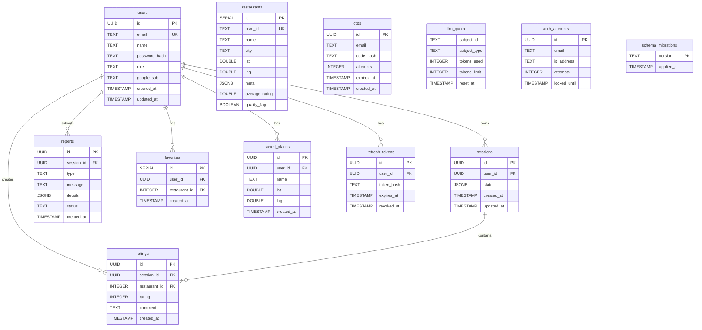
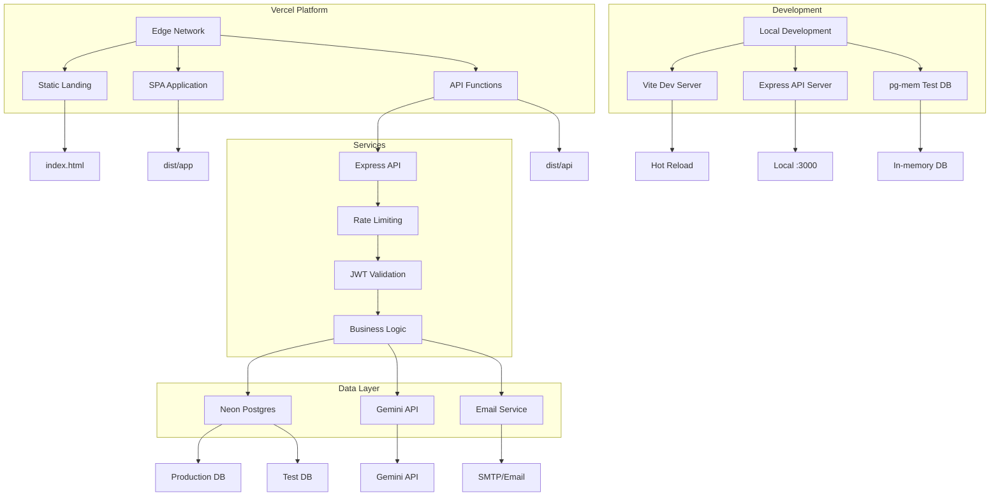
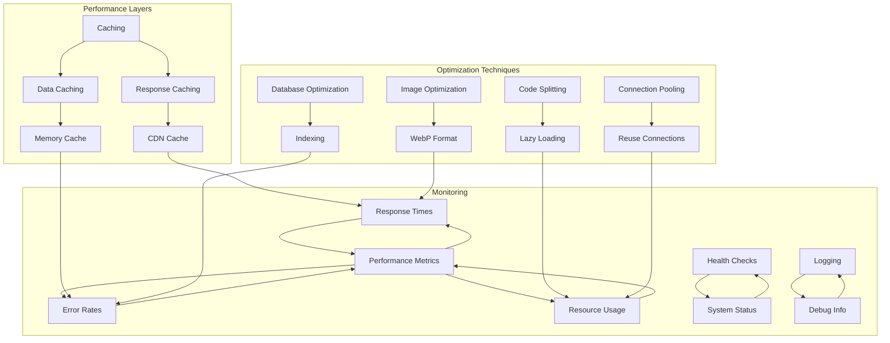

# Architecture Diagrams

This document contains visual representations of the NaijaTaste AI system architecture.

## System Overview

```mermaid
graph TB
  subgraph "Client Layer"
    A[Web Browser]
    B[Mobile App - PWA]
    C[API Clients]
  end
  
  subgraph "Frontend"
    D[Landing Page (/)]
    E[SPA Shell (/app)]
    F[React Components]
    G[Map Interface]
    H[Auth Screens]
  end
  
  subgraph "API Layer"
    I[Express API (/api)]
    J[Rate Limiting]
    K[JWT Middleware]
    L[Validation]
    M[Routes]
  end
  
  subgraph "Business Logic"
    N[Agent Loop]
    O[Chat Service]
    P[Recommendation Engine]
    Q[Review Generator]
    R[User Preferences]
  end
  
  subgraph "Data Layer"
    S[Postgres Database]
    T[User Store]
    U[Restaurant Data]
    V[Session Store]
    W[Rating Store]
  end
  
  subgraph "External Services"
    X[Gemini API]
    Y[Google Maps]
    Z[Email Service]
  end
  
  A --> D
  B --> E
  C --> I
  D --> E
  E --> I
  I --> J
  J --> K
  K --> L
  L --> M
  M --> N
  M --> O
  M --> P
  M --> Q
  M --> R
  N --> X
  O --> S
  P --> S
  Q --> X
  R --> S
  S --> T
  S --> U
  S --> V
  S --> W
  P --> Y
  O --> Z
```

## Data Flow

### User Registration Flow



### Restaurant Recommendation Flow



### Authentication Flow



## Component Architecture

### Frontend Components



### Backend Architecture



## Database Schema

### Entity Relationship Diagram



## Deployment Architecture



## Security Architecture

```mermaid
graph TD
    subgraph "Security Layers"
        A[Rate Limiting] --> B[Input Validation]
        B --> C[JWT Authentication]
        C --> D[Authorization]
        D --> E[Data Encryption]
        E --> F[Secure Headers]
    end
    
    subgraph "Authentication Flow"
        G[User Login] --> H[Password Verification]
        H --> I[JWT Generation]
        I --> J[Token Storage]
        J --> K[Token Validation]
        K --> L[Access Granted]
    end
    
    subgraph "Authorization Levels"
        M[Public Routes] --> N[/health, /nearby]
        O[User Routes] --> P[/auth/*, /chat/*]
        Q[Admin Routes] --> R[/admin/*]
    end
    
    subgraph "Security Measures"
        S[CORS Protection] --> T[Header Validation]
        U[SQL Injection Prevention] --> V[Parameterized Queries]
        W[XSS Protection] --> X[Output Encoding]
        Y[CSRF Protection] --> Z[Token Validation]
    end
    
    A --> G
    B --> G
    C --> G
    D --> O
    E --> F
    F --> S
    F --> U
    F --> W
    F --> Y
```

## Performance Architecture

