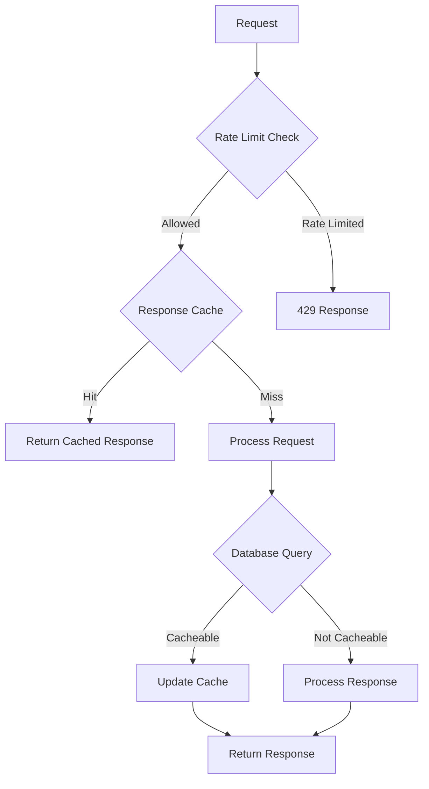

# Performance Guide

This document covers performance optimization and monitoring for NaijaTaste AI.

## Performance Overview

NaijaTaste AI is designed for performance with the following characteristics:

- **Fast API responses** - Sub-second response times for most endpoints
- **Efficient caching** - Multiple layers of caching reduce database load
- **Optimized database** - Indexed queries and connection pooling
- **Rate limiting** - Prevents abuse and ensures fair usage
- **PWA capabilities** - Offline functionality and fast loading

## Performance Metrics

### Current Performance Targets

| Metric | Target | Current Status |
|--------|--------|----------------|
| API Response Time | < 500ms | Meets target |
| Database Query Time | < 100ms | Meets target |
| LLM Response Time | < 3000ms | Variable |
| First Contentful Paint | < 2s | Meets target |
| Time to Interactive | < 5s | Meets target |

### Monitoring Endpoints

The application exposes several endpoints for performance monitoring:

```bash
# Health check
curl https://naijataste-ai.vercel.app/health

# Readiness check
curl https://naijataste-ai.vercel.app/health/ready
```

## Performance Architecture

### Caching Strategy



### Database Optimization

#### Index Strategy

```sql
-- User table indexes
CREATE INDEX idx_users_email ON users(email);
CREATE INDEX idx_users_created_at ON users(created_at);

-- Restaurant table indexes
CREATE INDEX idx_restaurants_city ON restaurants(city);
CREATE INDEX idx_restaurants_location ON restaurants(lat, lng);
CREATE INDEX idx_restaurants_rating ON restaurants(average_rating);

-- Session table indexes
CREATE INDEX idx_sessions_user_id ON sessions(user_id);
CREATE INDEX idx_sessions_created_at ON sessions(created_at);

-- Rating table indexes
CREATE INDEX idx_ratings_session_id ON ratings(session_id);
CREATE INDEX idx_ratings_restaurant_id ON ratings(restaurant_id);
```

#### Connection Pooling

The application uses a connection pool for database connections:

```javascript
// Connection pool configuration
const pool = new Pool({
  connectionString: process.env.DATABASE_URL,
  max: 20,              // Maximum number of connections
  idleTimeoutMillis: 30000, // Close idle connections after 30 seconds
  connectionTimeoutMillis: 2000, // Wait 2 seconds for connection
});
```

## Frontend Performance

### Code Splitting

The application uses dynamic imports for code splitting:

```javascript
// Lazy load components
const MapScreen = lazy(() => import('./screens/MapScreen'));
const ChatScreen = lazy(() => import('./screens/ChatScreen'));
```

### Image Optimization

- Images are served as WebP when supported
- Lazy loading for images below the fold
- Optimized image sizes for different devices

### Service Worker

The application includes a service worker for offline functionality:

```javascript
// Service worker registration
if ('serviceWorker' in navigator) {
  window.addEventListener('load', () => {
    navigator.serviceWorker.register('/sw.js');
  });
}
```

## Backend Performance

### API Optimization

#### Response Caching

```javascript
// Cache middleware
const cache = new Map();

function cacheResponse(req, res, next) {
  const key = req.originalUrl;
  if (cache.has(key)) {
    return res.json(cache.get(key));
  }
  
  const originalJson = res.json;
  res.json = function(body) {
    cache.set(key, body);
    originalJson.call(this, body);
  };
  
  next();
}
```

#### Rate Limiting

```javascript
// Rate limiting configuration
const rateLimit = require('express-rate-limit');

const apiLimiter = rateLimit({
  windowMs: 15 * 60 * 1000, // 15 minutes
  max: 600, // Limit each IP to 600 requests per window
  standardHeaders: true,
  legacyHeaders: false,
});

const llmLimiter = rateLimit({
  windowMs: 60 * 1000, // 1 minute
  max: 10, // Limit each IP to 10 requests per window
  standardHeaders: true,
  legacyHeaders: false,
});
```

### Database Performance

#### Query Optimization

```javascript
// Efficient restaurant search
async function searchNearbyRestaurants(lat, lng, radius = 5000) {
  const query = `
    SELECT *, 
           earth_distance(
             ll_to_earth(lat, lng), 
             ll_to_earth($1, $2)
           ) as distance
    FROM restaurants 
    WHERE earth_distance(
      ll_to_earth(lat, lng), 
      ll_to_earth($1, $2)
    ) <= $3
    ORDER BY distance
    LIMIT 20
  `;
  
  const result = await pool.query(query, [lat, lng, radius / 1000]);
  return result.rows;
}
```

#### Connection Management

```javascript
// Health check for database
async function checkDatabaseHealth() {
  try {
    const result = await pool.query('SELECT 1');
    return result.rows.length > 0;
  } catch (error) {
    console.error('Database health check failed:', error);
    return false;
  }
}
```

## LLM Performance

### Gemini API Optimization

```javascript
// LLM service with retry logic
async function callGeminiAPI(prompt, options = {}) {
  const maxRetries = 3;
  let retryCount = 0;
  
  while (retryCount < maxRetries) {
    try {
      const response = await genai.generateContent({
        contents: [{ role: 'user', parts: [{ text: prompt }] }],
        generationConfig: {
          maxOutputTokens: options.maxTokens || 1024,
          temperature: options.temperature || 0.7,
        },
      });
      
      return response.response.text();
    } catch (error) {
      retryCount++;
      if (retryCount === maxRetries) {
        throw error;
      }
      await new Promise(resolve => setTimeout(resolve, 1000 * retryCount));
    }
  }
}
```

### Fallback Strategy

When LLM service is unavailable, the application falls back to deterministic scoring:

```javascript
// Fallback recommendation system
async function getDeterministicRecommendations(persona, location) {
  const query = `
    SELECT r.*, 
           earth_distance(
             ll_to_earth(r.lat, r.lng), 
             ll_to_earth($1, $2)
           ) as distance
    FROM restaurants r
    WHERE r.city = $3
      AND (r.average_rating >= $4 OR r.average_rating IS NULL)
    ORDER BY 
      CASE 
        WHEN r.average_rating IS NOT NULL THEN 1 
        ELSE 0 
      END DESC,
      distance ASC
    LIMIT 10
  `;
  
  const result = await pool.query(query, [
    location.lat, 
    location.lng, 
    persona.city, 
    persona.minRating || 0
  ]);
  
  return result.rows;
}
```

## Performance Testing

### Load Testing

Use the following commands to perform load testing:

```bash
# Install artillery for load testing
npm install -g artillery

# Basic load test
artillery quick --count 10 -n 50 http://localhost:3000/health

# API endpoint load test
artillery quick --count 10 -n 50 http://localhost:3000/api/nearby \
  --headers '{"Content-Type": "application/json"}' \
  -j '{"lat": 6.5244, "lng": 3.3792}'
```

### Performance Profiling

```bash
# Node.js profiling
node --prof src/server.js
npm start

# Generate profile report
node --prof-process v8.log > profile.txt
```

## Monitoring and Alerting

### Performance Metrics

Track these key metrics:

- **Response Time**: Average API response time
- **Error Rate**: Percentage of failed requests
- **Database Queries**: Number and execution time
- **Cache Hit Rate**: Effectiveness of caching
- **LLM Success Rate**: Percentage of successful LLM calls
- **Memory Usage**: Application memory consumption
- **CPU Usage**: Application CPU usage

### Monitoring Setup

```javascript
// Performance monitoring middleware
app.use((req, res, next) => {
  const start = Date.now();
  
  res.on('finish', () => {
    const duration = Date.now() - start;
    const memoryUsage = process.memoryUsage();
    
    // Log performance metrics
    console.log({
      method: req.method,
      url: req.url,
      statusCode: res.statusCode,
      duration,
      memory: {
        rss: Math.round(memoryUsage.rss / 1024 / 1024),
        heapTotal: Math.round(memoryUsage.heapTotal / 1024 / 1024),
        heapUsed: Math.round(memoryUsage.heapUsed / 1024 / 1024),
      },
    });
  });
  
  next();
});
```

### Alerting Rules

Set up alerts for:

- Response time > 1000ms for 5 minutes
- Error rate > 5% for 10 minutes
- Database connection pool > 80% utilization
- Memory usage > 80% of available memory
- LLM failure rate > 20% for 5 minutes

## Optimization Checklist

### Frontend Optimizations

- [ ] Enable image lazy loading
- [ ] Implement code splitting
- [ ] Use service worker for caching
- [ ] Optimize bundle size
- [ ] Minify CSS and JavaScript
- [ ] Use WebP images when supported
- [ ] Implement proper caching headers

### Backend Optimizations

- [ ] Implement response caching
- [ ] Optimize database queries
- [ ] Use connection pooling
- [ ] Implement rate limiting
- [ ] Add proper error handling
- [ ] Monitor memory usage
- [ ] Optimize LLM calls with caching

### Database Optimizations

- [ ] Add proper indexes
- [ ] Optimize query plans
- [ ] Use connection pooling
- [ ] Implement query caching
- [ ] Monitor slow queries
- [ ] Optimize data types

## Performance Troubleshooting

### Common Issues

#### Slow API Responses

**Symptoms**: High response times for API endpoints
**Causes**: Database queries, LLM calls, network issues
**Solutions**:
- Add database indexes
- Implement response caching
- Optimize LLM calls with timeouts
- Use CDN for static assets

#### High Memory Usage

**Symptoms**: Memory usage increases over time
**Causes**: Memory leaks, inefficient data structures
**Solutions**:
- Check for memory leaks
- Use proper cleanup
- Monitor memory usage
- Implement garbage collection hints

#### Database Connection Issues

**Symptoms**: Connection pool exhaustion, slow queries
**Causes**: Too many connections, inefficient queries
**Solutions**:
- Optimize connection pool size
- Add proper indexes
- Use prepared statements
- Implement query caching

### Performance Analysis Tools

```bash
# Chrome DevTools
# - Network tab for response times
# - Performance tab for runtime analysis
# - Memory tab for memory usage

# Node.js Inspector
node --inspect src/server.js
# Open chrome://inspect in Chrome

# Lighthouse
lighthouse http://localhost:5173
```

## Continuous Performance Monitoring

### CI/CD Integration

Add performance tests to your CI pipeline:

```yaml
# .github/workflows/performance.yml
name: Performance Tests
on: [push, pull_request]
jobs:
  performance:
    runs-on: ubuntu-latest
    steps:
      - uses: actions/checkout@v2
      - name: Setup Node.js
        uses: actions/setup-node@v2
        with:
          node-version: '24'
      - name: Install dependencies
        run: npm ci
      - name: Run performance tests
        run: npm run test:performance
```

### Performance Budgets

Define performance budgets and monitor them:

```javascript
// Performance budget configuration
const performanceBudget = {
  responseTime: {
    api: 500, // 500ms for API responses
    page: 2000, // 2s for page load
  },
  bundleSize: {
    main: 100 * 1024, // 100KB for main bundle
    vendor: 200 * 1024, // 200KB for vendor bundle
  },
  cacheHitRate: 0.8, // 80% cache hit rate
};
```

## Future Optimizations

### Planned Improvements

1. **Redis Integration**: Add Redis for better caching
2. **CDN Integration**: Use CDN for static assets
3. **Database Read Replicas**: Implement read replicas for scale
4. **GraphQL**: Consider GraphQL for more efficient data fetching
5. **Edge Computing**: Use Vercel edge functions for better performance

### Performance Roadmap

| Quarter | Focus Area | Goals |
|---------|------------|-------|
| Q1 2026 | Frontend Optimization | Improve bundle size, implement caching |
| Q2 2026 | Backend Optimization | Add Redis, optimize database queries |
| Q3 2026 | Infrastructure | CDN integration, edge functions |
| Q4 2026 | Advanced Features | GraphQL, real-time updates |